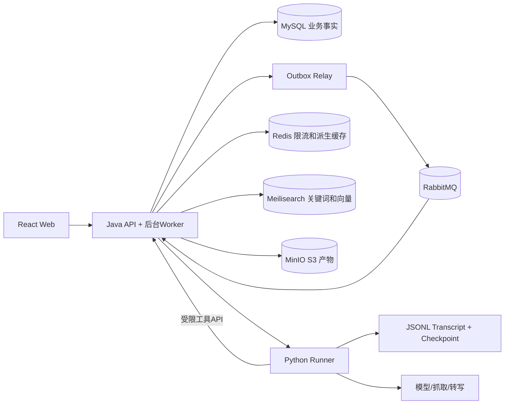

# 02 架构与后端开发

## 1. 总体架构与数据权威



MySQL决定内容、权限、发布版本、任务、审批、记忆和用量；MinIO保存不可变原文件/正文/转录/快照；Meili提供可重建索引；Redis提供短时限流与派生缓存；Rabbit传递至少一次通知。任何缓存、消息和向量命中都不能绕过数据库权威状态复核。

Java不能解析网页或调用模型。Runner没有MySQL、MQ、Meili或MinIO管理员凭据；它通过HTTP获取有授权的输入、返回产物、调用受限业务工具。Java消费Rabbit通知后协调Runner，不能又让Runner直接消费同一条业务消息。

首版单机单管理员，部署八个服务。Java模块化单体，不引入服务发现、网关平台或Kubernetes。单节点MQ和对象存储只能说明单机持久性，不代表高可用。

## 2. 包结构与职责

```text
backend/src/main/java/com/larder/
  identity/     SessionController OwnerService SecurityConfig
  content/      ItemController ItemService RevisionPublisher ArtifactService
  ingest/       UrlNormalizer DedupService ContentFingerprint
  pipeline/     JobService OutboxRelay WakeConsumer LeaseRepository RunReconciler
  indexing/     GenerationBuilder GenerationValidator GenerationPublisher
  search/       SearchService CandidateRetriever RrfFusion AuthoritativeFilter
  organize/     TagService CollectionService NoteService
  learning/     CardService ReviewScheduler ReviewService
  assistant/    ToolGateway ProposalService ApprovalService MemoryService
  runner/       RunnerClient RunEventReceiver ArtifactReceiver
  platform/     BudgetService AuditService RateLimiter MaintenanceService
  common/       ErrorCode TraceContext PageCursor ClockConfig
```

每个包按需要设api/application/domain/infrastructure；不提前生成空的四层模板。Controller负责协议，应用服务负责事务，domain放状态/算法，infrastructure放Mapper和客户端。跨包通过应用接口调用，不跨包直接改Mapper。统一错误、traceId和时钟工具，不在common堆业务规则。

Java21 + Boot4.1（4.1.2）+ MyBatis-Plus boot4 starter；Flyway、Security、Spring AMQP等优先由Boot BOM管理（Boot 4 把自动配置按技术拆成模块，Flyway 必须用 spring-boot-starter-flyway）。HTTP客户端选一种，不同时混入多个重试/熔断栈。精确依赖在V01做兼容实验后锁定；Boot 4 升级已按 ADR-0002 执行，原“默认不升Boot4”约束随之解除。

## 3. 内容、版本和存储发布

Item是可变入口；ContentRevision不可变；Chunk属于revision；IndexGeneration绑定revision、chunker、embedder和索引schema。item分别持有`current_revision_id`与`active_generation_id`，正文最新与搜索已发布可以暂时不同。

**收录事务**：写IdempotencyRequest→保守URL去重→创建Item及Job→写Outbox(JobWake)→记录响应快照→提交后202。唯一约束处理并发，不能“先查再插”代替唯一索引。同键不同body409；重复URL返回已有item，不自动重抓。

**正文发布**：Java先收取Runner产物、校验schema/hash/大小，写不可变MinIO对象；随后锁item/job，检查未删除、未取消、lease token有效、`job.processing_epoch == item.processing_epoch`；插入revision/chunks，更新current_revision，创建索引job和Outbox，完成原job。事务失败会留下未引用对象，不能留下指向不存在对象的有效正文。

每次显式重抓递增item.processing_epoch，旧job即使lease仍合法也不得覆盖新请求。新任务失败不破坏旧revision。产物对象键由服务器生成，包含item/revision或内容hash；用SHA-256验证内容，不将multipart ETag假定为正文hash。保存object version ID和大小，禁止同key覆盖不同内容。孤立对象列入可审查清单，用户数据默认不自动删除。

URL规范化只改安全的协议/主机大小写、默认端口等；路径、签名query、hash路由保留。短链每跳受SSRF策略约束。正文SHA-256用于完全相同检测；SimHash作为近似候选，阈值以含近似反例的样本评测，不自动合并用户原件和笔记。

## 4. Outbox → MQ → 长任务接管

### 4.1 投递与确认

1. Outbox与业务/job同事务，记录eventId、jobId、wakeGeneration、payloadHash、availableAt。
2. Relay用短事务抢占待发记录，提交后发消息；使用durable exchange/queue、persistent消息、mandatory routing与publisher confirm。
3. 只有确认ack且没有unroutable return时标SENT；nack、return或连接中断保留可重试状态。confirm已到但SENT没提交会重复投递，属于正常恢复路径。
4. Consumer手动ack、有限prefetch。消息仅是唤醒提示，先按jobId读MySQL验证当前状态，不以消息payload推进业务。
5. 在一个事务内记录Inbox(eventId)、取得或确认job的持久接管记录、保存runId/next_reconcile_at；此事务成功后可以ack。不能仅写Inbox“已处理”而没有可恢复的后续工作。
6. HTTP提交Runner不持有MQ未确认消息数分钟。后台执行器和Reconciler扫描已接管且到期的记录，负责调用/对账/续租；ack后进程崩溃也能从DB继续。

发布者confirm和消费者ack是两个不同方向，前者不证明业务已经完成。[RabbitMQ 确认机制](https://www.rabbitmq.com/docs/confirms)

默认队列采用可验证的持久队列配置；使用单成员quorum queue时明确只有一个副本。DLQ记录无法解析的协议消息和超过投递失败上限的通知；业务失败记录在job，不靠无限nack/requeue等待恢复。重试退避放MySQL next_attempt_at及Outbox availableAt，不依赖额外延迟插件。管理员重放通过“重试job”产生新wake事件，不能任意复活已取消/删除任务。

### 4.2 Job、Lease与fencing

状态：`QUEUED → RUNNING → SUCCEEDED / FAILED / NEEDS_DECISION`；可重试故障进入`RETRY_WAIT`再回RUNNING；取消进入CANCELLED；被新处理请求替代进入SUPERSEDED。状态、错误和事件同事务。

初始默认lease30秒、每10秒续约、对账每10秒；这些是待压测的设计参数。MySQL数据库时间是租约时间源。抢占使用条件更新或FOR UPDATE SKIP LOCKED，短事务内递增lease_token。执行外部I/O前释放数据库锁。

```sql
UPDATE job SET lease_until = UTC_TIMESTAMP(6) + INTERVAL 30 SECOND
WHERE id = :jobId AND lease_owner = :owner AND lease_token = :token
  AND status = 'RUNNING' AND lease_until > UTC_TIMESTAMP(6);
```

续租、结束、产物发布都检查同一组条件；发布还检查item.processing_epoch。影响行数为0必须停止提交。Redis/Redisson锁可减少维护任务争抢，但最终写入仍受MySQL token保护；不得用锁是否拿到判断业务正确性。[Redis 分布式锁讨论](https://redis.io/docs/latest/develop/clients/patterns/distributed-locks/)

lease接管不增加业务attempt，不更换runId。新worker先GET原run：已完成则拉产物，运行中恢复订阅，确认不存在才以同ID重交；明确终态失败且重试获准才增加attempt并换runId。SSE断开不等于任务失败，心跳不等于阶段进展，阶段deadline不等于HTTP空闲超时。

### 4.3 必测窗口与补偿

| 窗口 | 恢复 |
|---|---|
| DB提交成功、消息未发 | Relay补发Outbox |
| broker收到、confirm丢失 | 重发可能重复；Inbox+job状态安全接收 |
| Consumer持久接管后ack前崩溃 | 重投不重复创建run；DB扫描继续执行 |
| ack后、HTTP提交前崩溃 | Reconciler发现next_reconcile到期，用原runId提交 |
| Runner接受、Java响应丢失 | GET或同键POST，不产生第二run |
| 老worker过期后返回 | token或processing_epoch拒绝提交 |
| 取消/删除与完成竞争 | item/job锁内仲裁，生效取消后不得再发布 |
| 模型可能完成但响应丢失 | NEEDS_DECISION，不能当普通网络故障自动重发 |

补偿扫描覆盖未发Outbox、QUEUED长时间无wake、过期lease、到期reconcile、重试到期、索引task未完成。扫描是可靠性兜底，不替代正常MQ主路径。限每批数量、有退避、记录queue age；数据库故障时停止推进并保留状态。

## 5. IndexGeneration与可信检索

### 5.1 条目代次与发布屏障

每条item有自己的generation，不在每次更新时重建全库。一个generation固定：contentRevision、chunk集合hash、索引schema、embedding模型/维度、构建manifest。Meili文档ID含generationId和chunkId，不覆盖旧代次。

1. 生成chunks/必要embeddings，manifest记录每个chunk的文本hash、向量维度/hash和锚点。
2. 分批写Meili，保存所有taskUid，等待每个任务succeeded；不能将202视为完成。
3. 读回完整预期ID集合，比对数量、文本hash、schema、维度/向量字段。发现缺失或不一致则FAILED，旧代次不动。
4. MySQL短事务锁item和generation：检查处理epoch、目标revision、未删除、构建验证通过，再CAS切换active_generation_id。记录发布事件。
5. 搜索候选按数据库active_generation_id复核，未发布、失败或过时generation不可进入最终结果。旧结果页面打开其固定revision，不重定向到新版正文。

这是“外部构建完成后，数据库原子切换发布指针”，不是MySQL与Meili共同原子提交。Meili完全故障仍会影响全文搜索；旧代次保留只解决新构建失败，不构成外部存储灾备。[Meili异步操作](https://www.meilisearch.com/docs/capabilities/indexing/tasks_and_batches/async_operations)

默认关键词代次可独立发布，不依赖模型Key。开启向量增强时，为同revision建立带向量的新generation；embedding失败继续使用已发布关键词代次。跨模型迁移固定index profile，例如`content_<schema>_<embeddingProfile>`；查询向量缓存按profile隔离，不将不同维度混用。首版模型迁移在维护窗口完整重建和切换，不支持同时无限路由多个模型版本。

### 5.2 检索链路与分页

Meili关键词排名使用其ranking rules，不能声称是BM25。保留双路召回与RRF深度：关键词TopN + 纯语义TopN，按chunk身份融合 `score = Σ weight/(k+rank)`，初始k=60，权重和N在评测配置中固定，随后按item聚合展示。原生hybrid只作对照基线，不把它的内置融合冒充自己实现的RRF。

向量由Runner产生，Meili采用user-provided embeddings。Java只调用Runner向量接口，不直接调用模型供应商。查询向量走受预算约束的同步HTTP外观，内部仍记录run/call事实；超时退回关键词并保留runId供对账，不能盲目多次收费。Redis缓存键包含owner、normalizedQueryHash、model/profile、inputVersion，值有TTL；AI关闭不使用向量路径。[Meili混合检索](https://www.meilisearch.com/docs/capabilities/hybrid_search/overview)、[Search API](https://www.meilisearch.com/docs/reference/api/search/search-with-post)

候选复核：owner、未删除、activeGeneration、chunk归属、textHash、请求过滤条件。旧版还在active指针下时是合法已发布结果，返回`isLatestContent=false`提示；旧版被切换后新查询不再采用它。请求一致性以该次数据库复核快照为界，网络发送途中仍可能发生新修改。

候选分批补拉，上限例如5页/200条；达到上限返回partial和原因，不伪造完整total。索引存在未发布和旧generation可能降低有效召回，评测须单列publication_filter_miss。标题/标签为可变元信息：DB提交递增metadata_version并写Outbox，更新派生索引后校验版本；定期读回真实索引版本修复迟到覆盖。最终过滤以数据库为准。

Meili故障降级仅匹配标题和标签，限制查询长度/条数/耗时，不对正文做无界LIKE。完整性和可用性分开报告，不能把降级结果当全文搜索结果。

### 5.3 评测

固定语料、query/qrels、索引设置、embedder、硬件与并发。指标包括Document Recall@5、Hit@5、MRR、完整API P95及失败率。区分候选未召回、排序掉出、发布/权限过滤。对照keyword、semantic、原生hybrid、自实现RRF；BM25可作为离线研究基线，未实际实现时不得写入生产链路或简历。

## 6. Redis、预算与审计

Redis承担短窗口限流、query embedding缓存和可丢弃的统计缓存。计费额度、审批、幂等记录、session和任务事实留MySQL。缓存命中仍校验权限/版本，尤其记忆撤销不得只删一个cache key就算完成。

请求限流用原子Lua或成熟客户端，不手写多命令有竞争窗口的INCR/EXPIRE组合。Redis不可用时默认单实例按更保守的本地限流+MySQL每日预算继续；多实例部署若没有共享限流则拒绝相关高成本入口，不能失控开放。登录错误计数有DB兜底，不能因Redis故障绕过防暴力策略。

BudgetReservation在启动run前用MySQL事务预留最坏token额度。每个call获得独立grant，累计不超过run/day预算；usage按callId/usage版本幂等结算，UNKNOWN保留保守预留。供应商价格、token估算和实际账单分开，不能保证一个本地计数器绝对限制供应商收费。Java审计串联用户→job→run→call/proposal→业务效果，日志不包含秘密或完整正文。

## 7. 复习与组织

手动标签、集合和笔记无需模型。AI更改以proposal提交；编辑后的批准产生新actionHash，旧批准无效。笔记和卡片绑定revision/chunk，正文更新标记来源旧版，不自行搬迁。

`sm2-adapter-v1`四按钮映射：忘记0、困难3、一般4、简单5。初始ease2.5，`newEase=max(1.3,oldEase+0.1-(5-q)*(0.08+(5-q)*0.02))`；q<3时reps=0、interval=1；否则旧reps为0/1时分别1/6天，其余ceil(oldInterval*oldEase)，然后reps+1。due_at用服务端UTC时间加间隔天数；时区决定每日配额与展示，不改写已有到期时间。明确这是四按钮适配，非完整Anki调度复刻。

Review事务锁state，先查requestId重复，再检查expectedStateVersion，写log和新state一次提交。不同requestId并发只有一个推进；相同ID返回原结果。四卡型共用调度，leech基于lapse记录触发可解释提醒，由用户选择暂停；保留日志供FSRS未来对照，不能用模拟评分宣称真实记忆改善。

## 8. 认证、隔离与可观测

单管理员使用Spring Security同源Cookie session，session存在MySQL，HttpOnly/SameSite/CSRF与Origin/Host校验。没有多端需求不额外维护JWT刷新体系；run capability是内部授权凭证，与用户session分开。

所有查询带owner过滤，内部工具按run scope复核；原始S3对象不公开，下载经Java授权或短期限定对象URL。health分liveness、基础ready和可选组件degraded；Meili/模型故障不触发整站重启。指标至少覆盖Outbox年龄、confirm失败、DLQ、lease接管、stale提交拒绝、索引延迟、miss分类、Redis降级、未知调用和磁盘剩余。

## 9. 不做什么

不拆微服务，不用Redis锁代替持久提交校验，不持有MQ消息直到分钟级任务结束，不声称exactly-once外部调用，不因单用户而删掉保留的MQ/索引/对象存储机制，不自动清理用户历史和旧版本。
