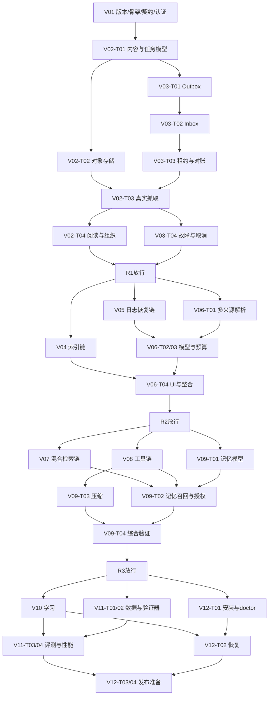

# 11 四轮、十二版本与并行开发 DAG

执行对象：协调 Agent、实现 Agent、验收 Agent。此文取代05中按版本顺序直接串行派工的解释；05仍负责工时估算及A01–A28测试定义。机器依赖唯一入口为 `tasks/tasks.json`，轮次/门禁定义为 `tasks/coordination.json`。编号顺序是产品里程碑顺序，不要求一个版本的全部代码写完后才能写下个版本；同轮内只要依赖、门禁和写入锁都满足，就可以并行。

## 1. 四轮交付与节奏

| 轮次 | 版本 | 基础预算 | 本轮最终演示 | 下一轮进入条件 |
|---|---|---:|---|---|
| R1 内容与可靠任务 | V01–V03 | 第1–4周，70h | 真实网页/粘贴→保存→任务进度→阅读；断MQ/重复消息/旧worker均不会错误发布 | R1-ACCEPTED：三版本全部集成、真实链路与A01–A07通过 |
| R2 可检索与可恢复模型 | V04–V06 | 第5–8周，82h | 可检索不可变版本；PDF/字幕；模型产物有引用；Runner崩溃可解释恢复 | R2-ACCEPTED：A08–A15、AI关闭降级、旧revision阅读通过 |
| R3 完整Agent内核 | V07–V09 | 第9–13周，94h | 混合检索→真实工具调用→审批写入→跨会话记忆→压缩后恢复 | R3-ACCEPTED：A16–A24、真实模型受限演示、撤销与审批竞争通过 |
| R4 产品与发布准备 | V10–V12 | 第14–18周，82h+52h缓冲 | 四卡型学习、八类Benchmark、新机恢复、完整安装和双模块证据 | R4-ACCEPTED：A25–A28、P01–P12、E01–E10、发布检查通过 |

每轮恰好3个版本。每版本4个核心工作包，共48包；8项实验另列L01–L08，安排在其先决机制完成后，总增40–80h。完整版含实验约420–460h；20–22周是按每周投入及返工的初估窗口，不是多人Agent可以自动压缩到几天的保证。个人需要理解实现、跑实验和复盘的时间不可省略。

**V02演示与V03基础设施交错**：先做V02-T01内容模型，再让对象存储与Outbox并行，等待V03-T03可靠执行入口就绪后完成V02-T03真实抓取。这样避免先做一套临时同步业务，后面整套推翻。05旧表中的“V02第2周真实内容闭环”在本执行方案下是目标预览窗口，正式闭环在R1完成；不把未完成V03可靠链路的演示当正式V02放行。

## 2. 每轮固定协议

1. **盘点**：协调者读取上轮集成证据、未关闭缺陷、真实代码和dirty文件，生成本轮基线清单。用户未授权commit时，使用文件hash清单，不擅自commit。
2. **冻结**：冻结本轮API/schema、事件、状态图、表设计、错误码、前端路由和设计token。新字段允许向后兼容扩展，但仍走变更协议。产物是 `reports/gates/Rx-CONTRACT/<runId>/`，含contractRev、文件hash、正常/异常fixture和所有消费者影响表。
3. **派工**：只分发满足依赖的工作包；跨语言包由协调者拆为带明确文件范围的2–6h子任务，禁止将同一整包交给多个窗口随意同时写。
4. **局部实现**：按任务卡编码、执行本任务检查，提交TASK_LOCAL_PASS或BLOCKED证据。局部通过不修改全局DONE。
5. **集成**：协调者检查基线与契约变化，集成文件，验收者在集成树上重跑边界检查。只有这时写全局DONE。
6. **版本放行**：四包DONE且版本特有场景通过，标VERSION_INTEGRATED。允许同轮的后续基础包先DONE，但不能宣布一个缺前置产品体验的版本已发布。
7. **轮次放行**：三版本集成，交叉场景和前端状态完成，报告ROUND_ACCEPTED；否则补缺陷，不自动降低门槛。下轮只能只读调研/设计草案，未经门禁不得开始依赖未稳定接口的生产实现。

R1-CONTRACT由V01-T03产出；V01四包先顺序执行，不依赖尚不存在的R1门禁。V02/V03要求R1-CONTRACT；R2/R3/R4任务分别同时要求前轮ACCEPTED和本轮CONTRACT。后续轮的契约冻结由协调者完成，是显式工作和报告，不能把门禁在JSON里改成ACCEPTED就算做完。

## 3. 可并行路径及必需先后关系

图为主路径摘要；完整依赖以机器任务表为准。尤其不能把V09-T02理解成“有向量搜索就能做记忆”：仍需Java权威生命周期、call授权和工具写入边界。

| 可以同时开发 | 成立条件 | 不能同时越界修改 |
|---|---|---|
| V02对象存储 / V03 Outbox | V02模型及R1契约已集成 | 同一Flyway迁移编号、job schema、root配置 |
| V02阅读UI / V03故障矩阵 | 真实抓取接口已通过 | 公用SSE客户端、错误词典由单一owner管理 |
| V04索引 / V05日志 / V06解析器 | R1放行且R2契约冻结 | Runner公共run DTO与artifact manifest |
| V07向量 / V08工具registry / V09记忆表 | R2放行且R3契约冻结 | 三条线各自不得发明call授权协议 |
| V08并发工具 / V08审批 | registry集成；写路径分离 | tool registry本体和公共错误码 |
| V09记忆召回 / V09压缩 | 各自依赖已DONE | 模型调用前最终context组装由协调者分配单owner |
| V10学习 / V11数据集与Verifier / V12打包 | R3放行且R4契约冻结 | CI入口、Compose、根依赖锁文件 |
| 前端不同feature | shell、tokens、generated types已冻结 | App路由表、Query key工厂、公共ui组件 |
| QA用例设计 / 实现 | 正常/异常fixture已冻结 | 不能让QA静默改业务规则使测试通过 |

严格前后：契约→消费者生成；真实对象写入校验→revision引用；外部索引任务完成→发布指针；durable job接管→MQ ack；journal稳定持久→模型call恢复；tool定义→受限执行；审批事务→业务写入；记忆授权→模型发送；上下文提交→后续重放；学习功能→对应真实Benchmark；备份验证→新实例恢复；全部验收→发布准备。此处的运行时顺序也必须被代码测试约束，不只是项目排期。

## 4. 十二版本的进入/退出合同

| 版本 | 进入时必须具备 | 退出时必须证明 | 主风险与检查点 |
|---|---|---|---|
| V01 | 本包可校验、仓库现状清楚 | 固定版本/镜像、八服务health、三端类型/契约、认证与验收脚本真实可跑 | 版本兼容/MinIO维护状态不明确时标阻塞，不编造digest |
| V02 | R1契约、内容schema、V03必要执行链 | 网页与粘贴至少各1条真实fixture，读取指定revision，失败保留输入，标签笔记可用 | 重复请求返回同一资源；未解析完成不展示伪正文 |
| V03 | 内容与job schema | A02–A07全部通过、SSE断线snapshot恢复、DLQ可诊断 | ack与HTTP派发解耦；过期worker、旧epoch双重拒绝 |
| V04 | R1放行 | A08–A10，索引构建失败仍能搜旧版本；恢复基线包含对象 | MySQL与Meili不是跨库原子事务；搜索必须权威复核 |
| V05 | R1放行、journal契约 | A11–A13、hash链/段/快照/UNKNOWN真实进程故障 | 不用截断历史修复；未知外部效果不自动重发 |
| V06 | 多来源解析、V05恢复与模型call机制 | A14–A15，结构化结果+引用定位、并发预算、关闭AI完整降级 | PDF扫描件/无字幕明确失败；预算记录不等于供应商账单绝对一致 |
| V07 | R2放行 | profile隔离、关键词/向量/RRF逐query对照、限流缓存降级 | Meili关键词不写成BM25；索引脏候选不能直接进入prompt |
| V08 | R2放行、tool schema | A18–A20，至少一个read与一个人工批准mutation的完整run | 参数变化、过期、目标变化必须拒绝；效果actionId幂等 |
| V09 | 记忆表、检索、审批、call授权 | A21–A24；旧缓存/旧context不能复活撤销记忆；压缩后能继续真实任务 | 区分已经授权在途call；压缩节省不能掩盖事实丢失 |
| V10 | R3放行、卡片契约 | 四卡型、四按钮评分、日界线、leech、AI关闭学习通过 | 重复/乱序评分与来源失效；不可用前端时间做调度权威 |
| V11 | 数据冻结、Verifier、被测功能集成 | 八类任务原始trace/预算/分母、人工rubric、消融与性能报告 | 失败和超时不从分母删除；不回填参考简历数字 |
| V12 | R4安装基础、V10与V11结果 | 新机安装、备份升级恢复、安全检查、已知限制、版本说明与证据包 | 发布就绪不自动获得push/外发/公开部署权限 |

## 5. 窗口数量与分配

**两窗口**：C（协调+集成+验收）、I（实现）。按依赖一次一个写任务；C在I实现时做独立审阅、设计fixture和运行隔离检查。跨语言工作包由I顺序完成，不同时编辑一个checkout。

**三窗口，推荐起步**：C、B（Java/基础设施）、R/W（按阶段切换Runner或Web）。R1中B做Outbox时另一个做storage适配或已有接口的UI；R2中B索引、R日志；前端以独立slice在锁释放后补齐。角色是责任而非永久只能写一种语言，派工卡才决定路径。C必须预留集成容量，不能同时接大量代码任务。

**五窗口**：C、B、R、W、Q。先冻结契约与UI底座，B/R/W并行，Q独立写契约/状态/故障验证并审查。跨端工作包拆 `.BE/.RUN/.WEB/.QA`；父包只有四类适用子项集成后才DONE。不适用子项写N/A原因，不能一律填N/A。更多窗口不自动增加吞吐；依赖链、同文件冲突、数据库迁移与真实模型配额仍串行。

每次派发前运行只读 `python scripts/plan_dispatch.py --state <绝对路径的状态快照> --batch <任务ID> ...`。它检查核心DAG、门禁与包级写入冲突，不自动创建worktree、不认领任务、不替代子任务的人工范围审查。没有状态文件时按全部未开始处理。

## 6. 子任务拆分与估时

工作包拆分记录到 `coordination/slices/<taskId>.json`：sliceId、parentTask、ownerId、dependsOnSlices、allowedPaths、exclusiveResources、contractRev、baseSnapshot、acceptanceIds、expectedHours。路径必须是父包范围子集；例外先记录变更请求，由协调者调整父包后再派发。公共文件只给一个slice，其他slice通过生成接口消费。

例如V08-T03拆：`.BE`审批模型/事务/action幂等；`.RUN`proposal提交及结果查询；`.WEB`diff/确认/过期状态；`.QA`A19/A20独立验证。BE与RUN可以在冻结契约下并行；WEB可先实现fixture状态；最终真实集成依赖BE+RUN，两端成功后QA测试才能作为父包完成证据。Mock UI通过只记局部证据，不提前完成父包。

每天或每完成2–3个slice汇总一次：剩余工作、被阻塞时间、一次集成通过率、返工来源。每轮结束重估下一轮。深度机制的前置依赖不因日期临近而跳过，优先减少不影响核心产品的装饰与扩展站点。

## 7. 不做什么

不把多个窗口等同于同时修改一个目录；不让Worker自行改全局任务DONE；不从DAG删除难依赖；不把演示Mock叫集成通过；不允许轮次放行替用户批准公开发布；不把可选视觉微调挤占核心机制实现。
