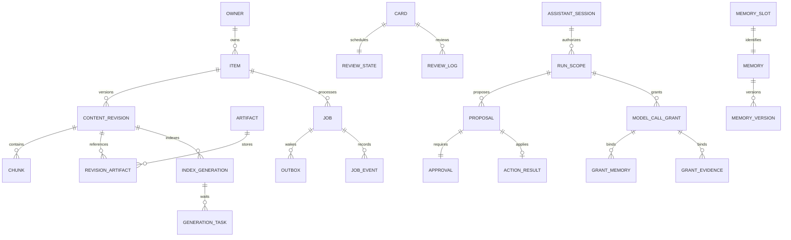

# 16 后端表设计与事务实施蓝图

执行对象：Java/SQL实现Agent、契约协调者和并发测试Agent。配套 [mysql-schema.sql](../contracts/mysql-schema.sql) 给出字段、类型、NOT NULL、唯一约束、索引、CHECK与关键归属外键，是可审查DDL设计基线。**本包没有对真实MySQL执行建表或性能测试**；V01/V02必须在全新隔离数据库验证后按轮次拆成Flyway迁移，不能直接导入用户库。禁止把设计SQL的存在写成“数据库已实现”。

## 1. 模块边界和权威来源

后端包保持02的identity/content/ingest/pipeline/indexing/search/organize/learning/assistant/runner/platform/common。approval、memory、session为assistant内子模块，storage/publication为content内子模块；不同时存在顶层approval包和assistant内第二套审批服务。每模块按需要api/application/domain/infrastructure，不预生成大量空目录。

| 存储 | 权威内容 | 不能承担的角色 |
|---|---|---|
| MySQL | 业务对象、身份权限、job/Outbox/租约、审批效果、记忆生效版本、预算、复习状态 | 不保存第二份Runner执行真相替代journal |
| S3/MinIO | 不可变原输入/正文/转录/产物及内容hash | 不以对象存在单独代表业务发布 |
| JSONL | Runner实际发生的事件、call意图/结果、context提交 | 不允许直接授予用户数据库写权限 |
| Meili | 可重建的内容与记忆候选索引 | 不作为权限、删除、记忆ACTIVE状态权威 |
| Redis | 派生缓存、限流、短时协调 | 不保证最终一次写入，不代替DB版本条件 |
| RabbitMQ | 至少一次通知与异步解耦 | 不等于业务状态数据库或长任务执行权威 |

Java assistant_message只保存可展示的用户消息/已提交回答投影及citation，不保存模型隐藏思维，也不能据此重建Runner尚未提交的内部执行状态。由run_receipt控制投影幂等。

## 2. 数据类型与公共规则

ID为不透明ASCII字符串，DDL上限64。V01统一选择生成器，不混用裸数值前端ID；客户端不从ID推权限。hash是小写hex SHA-256，64字符、ascii_bin；内容计算用约定规范化与UTF-8。普通文本utf8mb4；名称规范化先明确Unicode/空白/大小写策略，再写normalized_name的二进制比较列，不能依赖数据库默认排序规则猜用户意图。

时间统一DATETIME(6)+UTC连接；时区作为owner或事件快照单独保存。写入时间由服务端Clock/DB权威生成，不使用浏览器时钟裁定lease、审批或due。金额DECIMAL(18,8)，一次预算周期固定currency，浮点只用于有明确定义的检索评分。row_version、processing_epoch、lease_token、metadata_version、memory version语义不同，不互换。

软删除保留唯一键，重复URL命中回收站条目时返回原条目/恢复提示，不静默新建第二份。所有外键RESTRICT默认，不使用ON DELETE CASCADE扩大删除影响。不可变版本和日志原则上只插入；更正靠新版本和状态记录。

JSON仅用于版本化多态载荷、manifest、审计白名单、结果快照；查询/约束需要的owner、状态、版本、时间、幂等键等均为独立列。JSON入库前用schema验证并限定体积。DDL不能检查的跨字段业务语义见以下事务规则，不能以“数据库有FK”替代application权限校验。

## 3. 表组与关键设计

| 表组 | 设计与关键访问路径 |
|---|---|
| owner、app_session | session只存token/CSRF hash；owner保存timezone、settings_version和memory_policy_epoch；过期撤销查DB或短时可失效缓存 |
| item | current_revision_id与active_generation_id分离；owner+url_hash唯一；owner/deleted_at/created_at/id支撑资料库游标 |
| content_revision、chunk | item/revision_no唯一，revision/ordinal唯一；复合FK确保owner/item/revision/chunk属于同一链；正文与锚点不可变 |
| artifact、revision_artifact | bucket+key唯一，字节/hash/mime与对象版本记录；role+ordinal明确正文/原件/截图等角色；没有任意用户路径 |
| job | retry/lease/reconcile三类扫描各有索引；runId稳定、attempt仅真正重试变更；lease接管不能另造同一副作用调用 |
| outbox、inbox | publisher工作租约与业务worker租约独立；Inbox唯一consumer/event，持久接管后ack；死信可查但不自动删除 |
| job_event、run_receipt | job内seq与run内seq分别建唯一键；同seq不同hash是损坏；游标推进与业务应用同事务 |
| index_generation、generation_task | 固定revision/profile/schema/hash；外部批次task单独行跟踪；ACTIVE由item指针派生，DB不再维护第二套ACTIVE布尔 |
| metadata_projection | desired/applied版本与外部task观测；迟到写覆盖后可对账重新收敛，不声称外部API提供CAS |
| tag、item_tag、collection、collection_item | owner内规范名唯一；本设计条目可属于多个手动集合，连接表唯一；逆向索引支撑筛选；首版不做规则集合 |
| note、reading_position | note可无具体chunk，绑定chunk时必须有revision；进度按revision保存，切版本不偷偷复用旧锚点 |
| card、card_tag、review_state、review_log | 卡内容和复习状态分离；类型专属字段在严格schema JSON；评分log有请求hash和before/after；owner/day统计索引 |
| assistant_session、run_scope、run_scope_item、assistant_message | 会话与run分离；run scope显式固定资源/工具范围；消息为展示投影，不能扩展权限 |
| proposal、approval、action_result | proposal载荷不可变；审批绑定其hash/version；actionId唯一效果；同事务写业务与result审计 |
| memory_slot、memory、memory_version | scope/key槽位先锁；memory是稳定逻辑身份；version保存内容和墓碑；生成列唯一约束保证每memory最多一个ACTIVE |
| model_call_grant、grant_memory、grant_evidence | 每call绑定requestHash、预算预留和已复核记忆/证据版本；授权事务是撤销竞争的线性化点 |
| budget_day、reservation、usage_ledger | 原子预留、累计记录及差额结算；UNKNOWN不当零费用释放；usageVersion相同hash幂等 |
| idempotency_request、audit_event | owner+route+key唯一；命令结果快照与业务效果同事务；审计不含secret/私密正文 |

在16确立的多集合关联覆盖旧文档中不明确的“集合像文件夹”比喻；前端不能自行套用参考产品“一个条目一个集合”的限制。卡片标签显式card_tag，不假设必须继承原文标签；AI建议标签仍走确认语义。

## 4. 核心关系图



图省略复合owner键、查询索引及可空关联，实际以DDL和应用约束为准。关系图不是外键全集。

## 5. 八个必须实现的事务

### TX01 保存内容与幂等

认证后规范化请求并算bodyHash，申请owner/route/requestKey唯一记录；命中则比较hash，同hash返回已持久响应，异hash409。新请求事务写item/job/outbox/响应快照；已有规范URL返回原item并完成本次幂等响应。不能先SELECT不存在再INSERT而无唯一约束。冲突处理避免MySQL事务异常状态和框架回滚标记被错误复用；采取明确的insert-if-absent流程或回滚后只读查原结果。

网络/对象传输在事务外；只有输入已获得受控artifact或安全暂存引用时才创建可执行job。上传孤立文件的审查与清理不等于业务原件删除授权。

### TX02 durable接管与ACK

消费消息→读取job→事务内插入Inbox、验证当前job状态、分配/保持runId、写next_reconcile_at→提交→ACK。重复event查持久接管，不把Inbox存在当整个job完成。Reconciler独立扫描，ACK后进程死也能继续；HTTP提交不能放在事务里或ACK之前长时间等待。

### TX03 内容/索引发布

先在事务外写并校验对象/外部索引；再短事务锁必要job/item/generation，比较leaseToken、leaseUntil、processingEpoch、取消/删除、expectedVersion和生成版本归属；更新受影响行必须等于1。正文提交更新current_revision并创建索引job/Outbox；索引提交只切active_generation。旧索引仍可查询到的候选必须经过最新DB复核。

```sql
-- 说明性SQL，:named_parameters由Mapper绑定，不拼接。
UPDATE item
SET active_generation_id = :new_generation_id,
    row_version = row_version + 1,
    updated_at = :now
WHERE id = :item_id AND owner_id = :owner_id
  AND row_version = :expected_row_version
  AND processing_epoch = :expected_epoch
  AND deleted_at IS NULL;
```

这只是最后CAS，不能省掉前面锁内对job租约/候选generation READY与revision/manifest验证。更新0行应返回明确陈旧状态并保留构建产物，不悄悄变成成功。

### TX04 审批与一次业务效果

读取并锁目标资源（按稳定ID排序）、proposal/approval；验证owner/run、payloadHash、proposalVersion、targetVersions、expiry、APPROVED。action_result若存在，验证身份/hash后返回原结果；否则同事务执行业务、插入action_result、approval=APPLIED、audit/outbox。重复请求/响应丢失只查原action结果。仅在事务内不会调用外部副作用的动作可承诺此DB效果幂等；未来外部写工具必须另设计协议，不能套此承诺。

### TX05 记忆替代/撤销

先锁owner的memory_policy_epoch，再锁scope/key对应slot与memory；CAS验证版本，旧版本改SUPERSEDED或TOMBSTONED，新增替代版本或清除有效引用，递增policyEpoch，记录审计/索引任务。先使旧ACTIVE失效再插入新ACTIVE，整个事务对外原子；唯一生成列作为最后保护。墓碑不能因旧索引回流变ACTIVE。

### TX06 模型call授权与预算

按固定顺序锁owner→run_scope→budget_day及本次reservation；检查scope未过期撤销、memory refs与evidence仍有效、requestHash完整请求一致、总预算足够；插入grant与引用清单并提交，之后才允许Runner发送。撤销也先锁同owner，因此二者有明确串行顺序。已经提交授权的在途请求不能物理收回；后续call必须重新授权，不重用旧grant。

同call重复授权验证完整请求hash后返回原grant，不重复预留。UNKNOWN保留对应额度/不确定账目，按明确对账或人工决定处理；不能因TTL到了就释放一个可能已收费的请求。预算日采用UTC日并记录在reservation，不随重试跨午夜换日期；展示可按用户时区转换，计费日规则必须标明。

### TX07 usage幂等结算

唯一(callId,usageVersion)保护重复事件，重复hash相同返原结果，不同hash报告协议冲突。usage版本代表对该call的**累计用量快照**，不是每版追加消费额；锁reservation/budget_day，按最新已采纳累计值计算差额，只调整一次。迟到旧usageVersion保留记录但不覆盖新快照。估算/实报/未知分开，不能凭估算声称供应商最终账单。

### TX08 复习评分

查(cardId,requestId)，相同requestHash返原响应，异hash409；锁card/review_state，校验owner/ACTIVE/expectedStateVersion；纯ReviewScheduler按固定clock和版本计算新状态；更新状态+插入log before/after/response+审计同事务。UI翻面无数据库调度效果，只有评分提交成功改变due；重复翻卡不会多算复习次数。

## 6. 索引与并发策略

列表用 `(owner_id, deleted_at, created_at, id)` 稳定seek，倒序条件用createdAt/id二元游标；按类型筛选使用专用复合索引。大量标签组合按连接表逆向索引查询候选再限制，不为每种组合创建宽索引。真实索引选择由EXPLAIN ANALYZE与数据分布验证，设计包不预写毫秒收益。

worker扫描按state+nextTime+id有界批次，短事务 `FOR UPDATE SKIP LOCKED` 可用于领取；它不能作为最终提交正确性保证，仍需leaseToken/epoch。锁竞争和事务死锁不是不可能发生：固定对已存在资源的锁顺序，多目标按ID排序；死锁有限重试整个幂等事务，不能只重试最后一条SQL。数据库连接池、worker并发与外部超时共同限额。

记忆授权/撤销路径强制先owner锁；其他多对象事务参考owner→run_scope→budget_day→job→item/目标资源（稳定排序）→generation→proposal/approval→slot/memory→card/review→结果/audit。若某流程需要不同顺序，必须在ADR记录冲突图并统一相关事务，不能各模块自行定序。外键隐式锁也可能造成死锁，集成测试需覆盖，不能只靠手册顺序宣称无死锁。

## 7. 迁移拆分与DDL待验证点

V01 identity/session；V02 content/artifact/job/outbox基础；V03 inbox/event/receipt及任务索引；V04 generation/projection/组织恢复；V06 budget/run scope基础；V08 session/proposal/approval/action；V09 memory/grant refs；V10 card/review；V12新增仅必要运维元数据。**按实际FK顺序调整**：后续模块依赖的run_scope/job等基础表可提前建最小完整结构，不能创建指向不存在表的迁移。配套DDL的顺序是一次新库建立的依赖顺序，按版本拆分须重新跑全链路。

V01必须验证MySQL8.4真实语法、保留字、生成列索引、CHECK、复合FK、JSON长度和字符集；V02测试空库迁移与回滚后重跑；后续每版对旧fixture执行升级。不可只用H2代替MySQL语义。当前SQL不含DROP或清库脚本，不默认IF NOT EXISTS吞掉结构不一致；目标非空时拒绝直接导入。

关键静态与运行约束：actionId必须属于同proposal/hash；grant reservation必须属于同call/run/owner；assistant消息run必须属于同session；note/card引用整条归属链；nullable复合FK可能跳过校验，故相关CHECK与application验证不可省；state字段不等于完整状态机，合法转移仍在服务中断言。

## 8. 不做什么

核验依据：[MySQL8.4外键约束](https://dev.mysql.com/doc/refman/8.4/en/create-table-foreign-keys.html)、[CHECK约束与NULL语义](https://dev.mysql.com/doc/refman/8.4/en/create-table-check-constraints.html)、[锁定读与SKIP LOCKED边界](https://dev.mysql.com/doc/refman/8.4/en/innodb-locking-reads.html)。本设计外键目标均显式唯一，不能依赖非唯一目标键扩展；CHECK通过UNKNOWN，因此必要NULL组合另外约束。官方规则核验不等于本DDL已在真实数据库执行。

不以表数量当亮点；不把所有数据都放JSON；不把索引设计当实测优化；不跨存储宣称原子事务；不靠Redis锁覆盖DB校验；不允许物理删除级联清用户历史；不把这份DDL直接复制到现有数据库执行。
